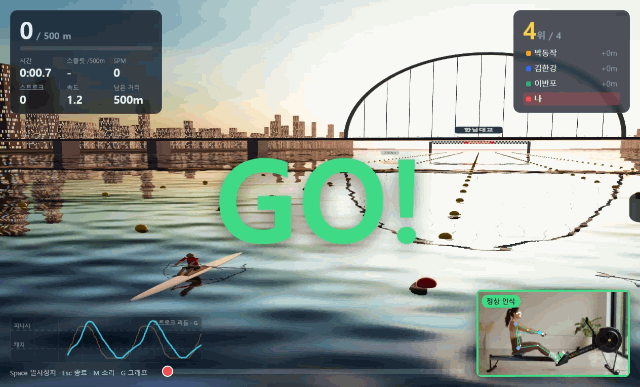
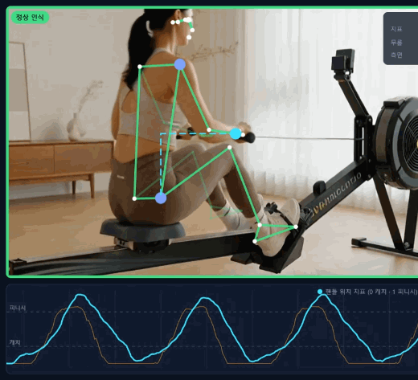
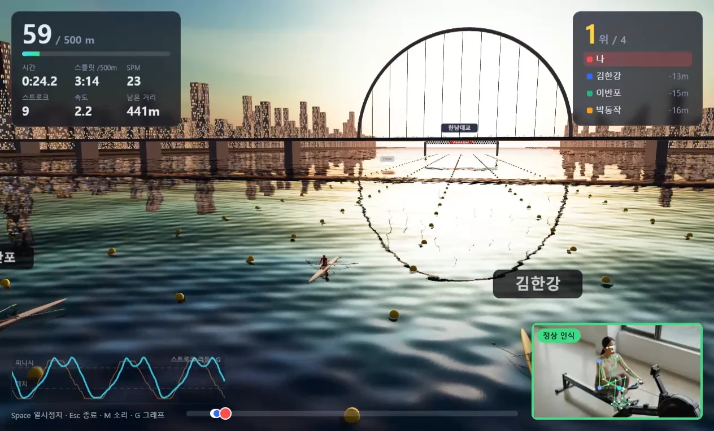

# Wakeline 🚣

**웹캠 자세 인식으로 노를 저어 3D 한강을 달리는 실내 로잉 게임.**
노트북 카메라로 로잉머신 위의 몸을 인식하고, 한 번 당길 때마다 게임 속 보트가 나아간다. 화면은 프로젝터로 띄워서 한다.



| 자세 인식 (골격 + 스트로크 파형) | 한강 레이스 |
| --- | --- |
|  |  |

▶ 원본 녹화 영상: [레이스](docs/media/race-demo.mp4) · [자세 인식](docs/media/pose-demo.mp4)

## 주요 기능

- **자세 인식**: MediaPipe Pose로 33개 관절을 30fps로 추적하고, 손목-엉덩이 거리로 만든 **핸들 위치 지표**(0 캐치 ~ 1 피니시)로 스트로크를 센다
- **카메라 점검 모드**: 게임 전에 영상·밝기·전신·거리·측면 각도·실제 노 젓기 3회를 확인하고 "준비 완료"를 띄운다
- **3D 한강 레이스**: 노을 하늘, 반사되는 강물, 강변 빌딩, 한강 다리, 레인 부표, 결승선. 내 캐릭터는 실제 동작(다리 → 몸통 → 팔)을 그대로 따라 노를 젓는다
- **AI 상대 3척**: 난이도별 목표 페이스로 스트로크마다 가속·감속하고, 막판에 스퍼트한다
- **기록 저장과 고스트**: 완주한 레이스를 저장하고, 같은 거리의 지난 기록과 반투명 고스트 보트로 대결한다
- **효과음**: 카운트다운, 시작·종료 휘슬, 노 젓는 소리, 속도에 따라 바뀌는 물소리. 소리 파일 없이 코드로 합성한다
- **프로젝터 출력**: 출력할 모니터를 골라 전체화면으로 띄우고, 다음 실행 때도 기억한다
- **오프라인**: 설치 후에는 인터넷 없이 동작하고, 카메라 영상은 저장하거나 전송하지 않는다

스택: Electron · Vite · TypeScript · Three.js · MediaPipe Pose Landmarker · Web Audio · IndexedDB

## 설치와 실행

**Node.js 22.12 이상**이 필요하다(개발 PC는 24.11에서 확인). 더 낮은 버전이면 `npm install`이 버전 안내와 함께 멈춘다.

```bash
npm install
```

```bash
npm start
```

설치하면 MediaPipe WASM과 포즈 모델(Lite/Full/Heavy)이 `public/`에 자동으로 받아진다. 받기에 실패했으면 `npm run setup:assets`로 다시 받는다.

| 명령 | 용도 |
| --- | --- |
| `npm start` | 빌드 후 앱 실행(실제 사용) |
| `npm run dev` | 개발 모드(코드 수정이 바로 반영) |
| `npm run web` | 브라우저로만 실행(http://127.0.0.1:5173) |
| `npm run build` | 타입 검사 + 빌드 |

## 사용 순서

1. **카메라 놓기**: 로잉머신 옆(측면) 2~3m에 카메라를 두고 전신이 보이게 맞춘다. 옆·약간 뒤쪽도 잘 인식된다
2. **카메라 점검**(`K`): 모든 필수 항목이 통과해 "준비 완료"가 뜨면 된다
3. **출력 화면**: "출력 화면"에서 프로젝터를 고르고 "이 모니터로 보내기"
4. **레이스 설정**: 난이도·거리·상대(AI/혼자)를 고르고, 원하면 👻 고스트로 지난 기록을 고른다
5. **🚣 레이스 시작**: 5초 카운트다운 후 휘슬과 함께 출발
6. **결과 화면**: 완주했으면 💾 기록 저장(`S`)

## 단축키

| 키 | 어디서 | 동작 |
| --- | --- | --- |
| `Space` | 레이스 | 일시정지 / 재개(3초 카운트다운) |
| `Esc` | 레이스 | 종료 확인(미완주) · 결과 화면에서는 처음으로 |
| `R` / `S` | 결과 화면 | 다시 하기 / 기록 저장 |
| `M` | 레이스 | 소리 끄기·켜기 |
| `G` | 레이스 | 스트로크 리듬 그래프 끄기·켜기 |
| `K` | 처음 화면 | 카메라 점검 모드 |
| `C` | 처음 화면 | 카메라(입력) 끄기·켜기 |
| `F11` / `F12` | 어디서나 | 전체화면 전환 / 개발자 도구 |

## 레이스

- 카운트다운 중에 저은 건 거리에 넣지 않는다
- 드라이브 중 핸들 지표가 올라가는 만큼 보트에 힘을 주고, 저항으로 서서히 감속한다(`physics` 설정)
- HUD: 거리·시간·스플릿(/500m)·SPM·스트로크·속도·남은 거리, 순위와 격차, 진행 막대, 다리 통과 알림
- 왼쪽 아래 반투명 **스트로크 리듬 그래프**(최근 8초)로 당기는 크기와 박자를 볼 수 있다
- 오른쪽 아래 카메라 창은 화면 해상도와 영상 비율에 맞춰 크기가 정해지고, 순위표·진행 막대가 카메라 창을 피해 배치된다
- 사람이 3초 넘게 안 보이거나 영상이 끊기면 자동으로 일시정지한다

### 난이도

"200회 당기면 약 1km, 9분 정도"(스트로크 1회 ≈ 5m, 4:30/500m, 약 22SPM)를 기준으로 맞췄다.

| 난이도 | AI 목표 스플릿 | AI SPM | AI 3척 |
| --- | --- | --- | --- |
| 쉬움 | 5:00/500m | 18~22 | 4:48 / 5:00 / 5:12 |
| 보통 | 4:30/500m | 20~24 | 4:18 / 4:30 / 4:42 |
| 어려움 | 4:00/500m | 22~26 | 3:48 / 4:00 / 4:12 |

실제로 200회에 1km가 아니라 X km가 나오면 `public/config/game.config.json`의 `physics.propulsionGain`(지금 4.6)에 1/X를 곱해 맞춘다. 조정할 수 있는 수치는 모두 이 파일에 있다.

### 효과음

| 소리 | 언제 |
| --- | --- |
| 삑 | 카운트다운 숫자가 바뀔 때, 일시정지 후 재개할 때(높은 삑) |
| 시작 휘슬 / 종료 휘슬 | 출발(GO!) / 결승선 통과 |
| 노 젓는 소리 | 내 노가 물을 잡을 때. 스트로크가 길수록 크게 |
| 옆 배 노 소리 | AI·고스트가 저을 때. 가까울수록 크게, 레인 방향대로 왼쪽/오른쪽에서 |
| 물소리 | 계속. 배가 빠를수록 크고 밝게 |

노 젓는 소리 5가지(실제 스컬 · 부드러운 물결 · 깊고 묵직하게 · 가볍고 경쾌하게 · 처음 버전)와 물소리 6가지(강물 · 선체가 물 가르는 소리 · 찰랑이는 물결 · 빠른 물살 · 처음 버전 · 끄기)를 패널에서 고른다. ▶로 미리 듣고 재생 중에는 ⏹로 멈춘다. 종류를 바꾸면 처음부터 다시 들려준다.

## 기록 저장과 고스트

- **완주한 레이스만** 결과 화면에서 저장할 수 있다. 레이스 요약과 모든 스트로크(시각·거리·길이·드라이브/리커버리·SPM)가 저장된다
- 기록은 **거리별로** 관리된다. 1km 레이스는 1km 기록으로 저장되고, 1km를 고르면 1km 고스트만 보인다
- 👻 고스트는 같은 거리 기록을 최대 3개 골라 함께 달린다. 저장된 스트로크 타임라인 그대로 움직이는 반투명 보트이고, 플레이어 바로 옆 레인에 놓인다
- 기록 이름은 겹치지 않는다. 같은 이름이 있으면 `(2)`, `(3)`…을 붙이고, 고스트 이름표가 AI 이름과 같으면 `(기록)`을 붙인다
- 저장한 기록 목록: 거리별로 묶어 보여주고 ⭐로 거리별 최고 기록을 표시한다. 이름 바꾸기, 삭제, 📤 파일로 내보내기 / 📥 가져오기(다른 PC로 옮기기·백업)
- 저장 위치: 앱의 IndexedDB(Electron 사용자 폴더 `%APPDATA%\wakeline`)

## 카메라 점검 모드

| 항목 | 통과 기준 | 필수 |
| --- | --- | --- |
| 카메라 영상 | 20fps 이상 | ✓ |
| 밝기 | 평균 밝기 70~215 | 권장 |
| 사람 인식 | 최근 2초 중 90% 이상 인식 | ✓ |
| 전신 보임 | 어깨·손목·엉덩이·무릎·발목이 보이고 화면 끝에 걸리지 않음 | ✓ |
| 거리 | 몸이 화면의 30% 이상 | 권장 |
| 측면 각도 | 좌우 어깨·엉덩이가 겹쳐 보임 | 권장 |
| 노 젓기 확인 | 캐치→피니시 3회 감지 | ✓ |

통과하지 못한 항목은 위쪽에 해결 방법을 크게 안내한다(프로젝터로 멀리서도 보이게).

## 카메라 없이 테스트하기

- **동영상 파일**: "입력"에서 **📁 동영상 파일 열기…**를 고르거나 영상을 창에 끌어다 놓는다. 반복 재생되고, 재생 속도(0.25×~2×)와 상관없이 영상 속 시간으로 잰다
- **화면/창 캡처**: 유튜브처럼 내려받을 수 없는 영상은 다른 창에서 재생하고 **🖥 화면/창 캡처…**로 그 창을 고른다
- **3D 합성 영상**: `npm run make:video`로 로잉머신에서 노를 젓는 3D 사람 영상(30초, 24SPM, 반복 재생용)을 만든다

### 자동 테스트 실행 옵션 (개발용)

```bash
npm run build
```

```bash
npx electron . --test-video=test-videos/sample1.mp4 --start-race=500 --log-metrics --snapshot-dir=./snaps
```

| 옵션 | 동작 |
| --- | --- |
| `--test-video=<파일>` | 시작하면 이 동영상을 입력으로 연다 |
| `--open-url=<주소>` / `--test-capture=<제목>` | 테스트 영상 페이지를 보조 창으로 열고 / 제목이 맞는 창을 캡처 입력으로 고른다 |
| `--start-check` | 카메라 점검 모드로 시작한다 |
| `--start-race=<거리>` / `--difficulty=<easy\|normal\|hard>` | 입력이 잡힌 뒤 AI 레이스를 자동 시작한다 |
| `--auto-save` / `--ghosts` | 결과를 자동 저장 / 같은 거리 최근 기록을 고스트로 고른다 |
| `--log-metrics` | 1초마다 인식 상태·fps·지표·레이스·효과음을 터미널에 찍는다 |
| `--snapshot-dir=<폴더>` | 5초마다 앱 화면을 PNG로 저장한다 |
| `--profile-dir=<폴더>` | 기록·설정을 따로 저장한다(테스트 기록이 실제 기록과 섞이지 않게) |
| `--window-size=<가로x세로>` | 창 크기(해상도별 화면 배치 확인용) |
| `--mute-audio` | 소리 끄고 실행 |

README의 GIF·스냅샷은 `npx electron scripts/make-readme-media.cjs`(ffmpeg 없이 Chromium으로 영상에서 추출)로 만든다.

## 폴더 구조

```
electron/        메인 프로세스(창, 모니터 선택, 전체화면, 카메라·화면 캡처 권한, 테스트 옵션)
public/config/   game.config.json (난이도·물리·인식 등 조정 수치)
public/maps/     맵 정의(han-river/map.json: 다리 이름·위치, 강폭, 해 고도)
src/pose/        카메라·동영상·화면 캡처 입력, MediaPipe 래퍼, 핸들 위치 지표
src/check/       카메라 점검 판정
src/game/        스트로크 감지, 보트 물리, AI, 고스트, 레이스 진행, 3D 장면, 효과음
src/data/        기록 저장소(IndexedDB)
src/ui/          화면(오버레이, 그래프, 점검, 레이스, 기록 패널)
src/tools/       3D 로잉 테스트 영상 생성기
scripts/         에셋 설치, 테스트 영상 만들기, README 미디어 만들기
docs/media/      README 이미지·GIF·데모 영상
```
